# FilingLens

Hybrid-search RAG over SEC 10-K filings. Ask a question in plain English and get an answer streamed back with inline citations to the exact passages it used, or a refusal when the filings don't support an answer. Every query shows the retrieved passages with their BM25, dense, fusion and rerank scores, plus per-stage latency, token use and cost.

The project is about **measuring** retrieval quality, not just building it. A hand-verified golden question set and LLM judges score every pipeline change against a frozen baseline, and CI posts the metrics diff on each pull request and fails on regressions.

**Built from scratch, with no libraries.** The backend and the API gateway use only the Python standard library: no web framework, vector database, search engine, or ML/eval package. BM25, cosine search, rank fusion, the HTML parser step, the eval metrics, the rate limiter and the reverse proxy are all written here. The frontend is React and TypeScript.

## Status

| Area | State |
| --- | --- |
| Ingestion: EDGAR discovery, HTML to sections and Markdown tables, chunking, idempotent re-ingest | Built, tested against real Apple and Microsoft filings |
| Retrieval: dense baseline, BM25, reciprocal rank fusion, metadata filters | Built |
| Generation: streamed cited answers (Anthropic API over raw HTTP), `NOT_FOUND` refusals | Built; offline-tested with mocked HTTP, not yet run against the live API |
| Embeddings: Voyage AI over raw HTTP | Built; offline-tested with mocked HTTP, not yet run against the live API |
| Eval harness: Recall@k, MRR, nDCG, golden-set tooling, LLM judges, judge calibration, CI gate | Built; judges untested against a live model |
| API gateway: allowlist, admin auth, rate limits, validation, streaming, cancellation | Built and tested |
| Frontend: ask view, sources, trace bar, experiments tab, demo mode | Built |
| GitHub Actions: tests, frontend build, eval diff on PRs | Written; not yet run on GitHub (this folder is not a git repo yet) |
| Golden set (150-200 verified questions), recorded baseline, `v0-baseline` tag | **Not done**: needs your API keys and hand review |
| Cross-encoder reranker, section-aware chunking, query rewriting | Not built (weeks 5-6 of the plan) |
| Timeouts and fallbacks, caching, tracing export, load test, public demo | Not built (weeks 7-8) |

There are no benchmark results in this repo yet. The experiment log fills in once the baseline is recorded.

## How it works

<p align="center">
  
</p>

The ingestion worker writes filings, chunks and vectors into SQLite. The eval harness (dashed arrow) runs golden questions through the same query path that users hit, so evals measure exactly what users get.

**Query path.** The gateway validates the request and forwards it. The retrieval service runs the configured stages (`baseline` is dense only; `hybrid` is BM25 plus dense merged with reciprocal rank fusion), applies company and year filters, and returns ranked chunks with per-stage scores. The backend emits the passages as citations first, then streams the answer, then a trace with stage timings, tokens and cost. If no retriever clears its confidence threshold, or the model replies `NOT_FOUND`, it sends a refusal instead of an answer.

**Ingestion.** Given tickers and years, the worker finds each 10-K on EDGAR, splits it into Items (1A, 7, 8...), keeps tables as Markdown, chunks with overlap, embeds in batches, and writes everything in one transaction. A content hash makes re-ingest idempotent: unchanged filings are skipped, changed ones replace their old chunks, and switching embedding model re-embeds automatically.

**Evals.** The same query path is run over a golden set. Retrieval is scored with Recall@5, MRR and nDCG. Answers are scored with binary pass/fail judges for faithfulness, correctness and citation accuracy; refusal correctness is checked without a model. Questions are LLM-generated candidates that only count once you verify them by hand, and the judge's agreement with your own labels is measured so you know how far to trust it.

## Quick start

Requirements: Node 20+, Python 3.10+. Python needs nothing installed.

**1. Frontend only (demo mode).** An in-browser mock with fictional companies; no backend needed.

```bash
npm install
npm run dev                  # http://localhost:5173
```

**2. Full stack, offline.** Uses the built-in hashing embedder and a stub answer generator (it quotes the top passages), so it runs with no keys and no network, apart from the EDGAR download.

```bash
cd backend
cp .env.example .env         # set SEC_USER_AGENT to "YourApp you@example.com"
python3 scripts/ingest.py --tickers AAPL MSFT --years 2024      # or: python3 scripts/seed.py for fictional demo data
python3 main.py              # terminal 1: backend  :8000
python3 -m gateway           # terminal 2: gateway  :8080
```

Then create `.env.local` in the project root with `VITE_USE_MOCK=false` and restart `npm run dev`. The dev server proxies `/v1` to the gateway.

**3. Full stack, real models.** Add keys to `backend/.env`, then re-run ingest so documents are re-embedded:

```
EMBEDDING_PROVIDER=voyage     VOYAGE_API_KEY=...
ANTHROPIC_API_KEY=...         LLM_PRICE_IN=...   LLM_PRICE_OUT=...    # USD per million tokens
```

Cost per query is reported as 0 until you set the two price variables from the provider's pricing page.

**Tests.** `cd backend && python3 -m unittest discover tests` (49 tests, a few seconds) and `npm run typecheck`.

## Evaluating a change

```bash
cd backend
python3 scripts/golden.py generate --factual 50 --table 30 --multi-hop 30 --comparison 25 --unanswerable 25
python3 scripts/golden.py review                     # accept, edit or reject each candidate
python3 scripts/run_evals.py --label "v0 baseline" --pipeline baseline --baseline --judge
python3 scripts/calibrate_judge.py label --run <id> --metric faithfulness --n 30
python3 scripts/run_evals.py --label "+ BM25 hybrid (RRF)" --pipeline hybrid --judge
```

Each run is stored with its pipeline config, git SHA and per-question results, and appears in the UI's Experiments tab with deltas against the baseline. Full workflow, including CI setup: [backend/README.md](backend/README.md).

## Security model

The browser, and the public, only reach the gateway. It exposes four routes (`POST /v1/query`, `GET /v1/corpus`, `GET /v1/evals/runs`, `GET /healthz`), validates and rebuilds query bodies so clients cannot override the pipeline, rate-limits per IP, caps concurrent LLM queries, hides backend error details, and cancels the upstream request when a browser disconnects. Ingest, raw retrieval and eval runs are admin routes behind a bearer token and are off unless `ADMIN_TOKEN` is set. API keys live only in environment variables, and retrieved filing text is passed to the model as untrusted data with an instruction not to follow it.

## CI

`.github/workflows/ci.yml` runs the backend tests (Python 3.11 and 3.13) and the frontend typecheck and build on every push and pull request. `eval.yml` runs the eval diff: a 30-question subset on PRs that touch `backend/`, the full set nightly or on demand. It comments the metrics diff on the PR and fails if a quality metric drops more than 0.03 against the committed baseline. It skips itself, with a notice, until the secrets and the three data files exist. Setup steps are in [backend/README.md](backend/README.md#ci-setup-github-actions).

## Project layout

<p align="center">
  
</p>


## Design notes

- **Stand-ins for the plan's stack.** The design calls for Postgres with pgvector and OpenSearch. This build uses SQLite, brute-force cosine search and a hand-written BM25 index, each behind a small interface. That is fine at the target scale of a few hundred thousand chunks on one machine, and swapping them out later changes one module each.
- **The offline hashing embedder is a placeholder.** It makes the dense path work with no network, but its retrieval quality is weak. Record a baseline only after switching to a real embedding model.
- **Chunk ids are stable only while the parser and chunker are.** Golden questions point at chunk ids like `aapl-2024-0039`. If you change parsing or chunking, re-verify the golden set and re-export the baseline.
- **One backend process, SQLite.** Writers are serialised with a lock and the BM25 and vector indexes live in memory, reloaded after ingest. Fine for this scale; not a multi-instance design.

## Roadmap

1. Add keys, ingest 30-50 companies, build and verify the golden set, record the baseline, tag `v0-baseline`.
2. Cross-encoder reranker, section-aware chunking, optional query rewriting, each measured against the baseline.
3. Reranker timeout and fallback, embedding and query caches, OpenTelemetry-style traces, load test (p50/p95/p99).
4. Deploy a public demo behind the gateway with rate limiting; publish the experiment log, including what did not help.

## Deploy

`npm run build` writes the UI to `dist/`; any static host works, and demo mode needs no backend. For a full deployment, run the backend on localhost only, put the gateway in front, set `VITE_API_BASE_URL` to the gateway's public URL at build time, add the UI's origin to the gateway's `ALLOWED_ORIGINS`, and set `TRUST_PROXY=true` only if a proxy you control terminates TLS in front of it.
